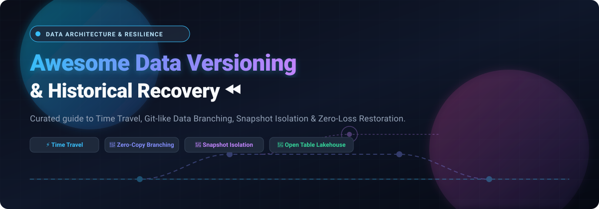

<div align="center">



# ⚡ Awesome Data Versioning & Historical Recovery ⏪

<p align="center">
  <strong>The definitive open-source & enterprise guide to Time Travel queries, Git-like Data Branching, Snapshot Isolation, and Point-in-Time Recovery.</strong>
</p>

<p align="center">
  <a href="https://github.com/ishandutta2007/Awesome-Awesome-Awesome"></a>
  <a href="https://discord.gg/jc4xtF58Ve"></a>
  <a href="https://github.com/ishandutta2007/Awesome-Data-Versioning-Historical-Recovery/stargazers"></a>
  <a href="https://github.com/ishandutta2007/Awesome-Data-Versioning-Historical-Recovery/network/members"></a>
  <a href="https://github.com/ishandutta2007/Awesome-Data-Versioning-Historical-Recovery/issues"></a>
  <a href="https://github.com/ishandutta2007/Awesome-Data-Versioning-Historical-Recovery/blob/main/LICENSE"></a>
  <a href="https://github.com/ishandutta2007"></a>
</p>

<p align="center">
  🌟 Star this repository if you find it helpful! 🌟
</p>

</div>

---

## 📌 Executive Summary & Search Intent

In modern data architecture, lakehouses, and MLOps, datasets change as frequently as application source code. **Data Versioning & Historical Recovery** encompasses the systems, table formats, and catalog engines that treat data with version-control semantics:
- 🕒 **Time Travel Queries**: Querying historical data states at specific points in time (`AS OF TIMESTAMP`) or transaction IDs (`AS OF VERSION`).
- 🌿 **Data Branching & Isolation**: Creating zero-copy isolated branches for dev, testing, and continuous ETL experimentation without copying petabytes.
- 📸 **Snapshot Isolation & ACID Transactions**: Preventing dirty reads and write skew during massive parallel distributed ingestion.
- 🛡️ **Point-in-Time Historical Recovery**: Effortlessly recovering from catastrophic ETL corruptions, accidental drops, or ransomware incidents.

---

## 📑 Table of Contents

- [📊 Sector Overview & Market Dynamics](#-sector-overview--market-dynamics)
- [🏢 SaaS & Hosted Platforms](#-saas--hosted-platforms)
- [🌐 Open-Source GitHub Projects](#-open-source-github-projects)
  - [Top Tier Version Control & Engines](#top-tier-version-control--engines)
  - [Open Table Formats & Catalogs](#open-table-formats--catalogs)
  - [ML Dataset & Artifact Versioning](#ml-dataset--artifact-versioning)
- [💡 Architectural Patterns & Selection Framework](#-architectural-patterns--selection-framework)
- [🤝 How to Contribute](#-how-to-contribute)
- [💖 Support & Sponsorship](#-support--sponsorship)
- [📈 Star History](#-star-history)
- [⚠️ Disclaimer](#️-disclaimer)

---

## 📊 Sector Overview & Market Dynamics

The global data versioning and dataset recovery sector is estimated at **$527M to $2.3B+** (as part of a broader **$15B–$31B+** data backup, recovery, and time-travel resilience market), driven by strict regulatory auditing, ML model reproducibility, and ransomware point-in-time recovery. 

The market exhibits **moderate fragmentation with high concentration around core lakehouse/cloud data warehouse platforms**: hyper-scalers and giants (Snowflake, Databricks, Microsoft/GitHub) dominate standard analytics workloads with winner-take-most dynamics, while specialized open-table and Git-for-data providers (lakeFS/Treeverse, DoltHub, DVC) cater to niche multi-cloud and Kubernetes-native versioning workflows.

---

## 🏢 SaaS & Hosted Platforms

A curated comparison of fully-managed hosted platforms providing enterprise time travel, table branching, and point-in-time recovery capabilities, sorted by **company valuation and revenue scale (descending)**:

| Product 🏷️ | Company Valuation / Revenue Scale 📈 | Starting Pricing 💳 | Free Tier Limits 🎁 | Key Highlights & Trade-offs ⚖️ |
| :--- | :--- | :--- | :--- | :--- |
| **[Git LFS (GitHub)](https://git-lfs.com/)** | Parent (Microsoft): ~$3.1T market cap; GitHub standalone ARR: **$2.0B+** | **$0.07/GiB/month** for storage + **$0.0875/GiB** for bandwidth out (metered beyond included allowance) | **Free Forever**: 10 GiB storage & 10 GiB monthly bandwidth included for GitHub Free/Pro accounts (250 GiB each for Enterprise) | Integrated directly into GitHub repositories; best for versioning large binary assets with code, but bandwidth/storage costs add up for massive datasets. |
| **[Databricks Delta Lake Time Travel](https://www.databricks.com/)** | **$134B valuation**; ARR: **$5.4B+** | Managed clusters start at **$0.07/DBU** (Standard) or **$0.22/DBU** (Premium) | **14-day free trial** with up to **$400 credits**; plus **Databricks Free Edition** (free forever with serverless compute daily quotas, 1 workspace/metastore) | Native table-level versioning & rollback (`VERSION AS OF`); open-core Delta Lake is Apache-2.0; requires regular `VACUUM` to clean old Parquet files. |
| **[Snowflake Time Travel](https://www.snowflake.com/)** | **~$50B–$60B market cap**; Annual Revenue: **$3.63B+** (FY2025) | On-demand Standard edition starts at **$2.00/credit** compute + **$23/TB/month** storage | **30-day free trial** with **$400 usage credits** (no permanent free storage/compute tier) | Native historical time travel queries and database cloning up to 1 day (Standard) or 90 days (Enterprise); zero configuration, but historical retained bytes add storage costs. |
| **[Pachyderm Enterprise (HPE)](https://www.pachyderm.com/)** | Parent (HPE): **~$32B market cap**; Annual Revenue: **$34.3B** | Enterprise licensing is quote-based upon contact (custom annual contracts per cluster/worker core) | **Free Forever**: Community Edition is 100% free & open-source on Kubernetes (unlimited pipelines, lacks enterprise RBAC/SSO) | Data-driven pipelines on Kubernetes with automated data provenance and lineage; requires Kubernetes infrastructure expertise. |
| **[Nessie (Dremio Cloud Catalog)](https://www.dremio.com/)** | Dremio Valuation: **$2.0B**; Total funding: $410M | Standard Pay-As-You-Go starts at **$0.20/DCU-hour** (e.g., 2XSmall engine at $3.20/hour) | **Free Forever**: Dremio Cloud Standard includes free catalog usage, capped at up to 10 users, 200 tables, and 1,000 views (plus 14-day Enterprise trial) | Catalog-level Git semantics (branch, tag, merge) for Apache Iceberg; enables isolated multi-table transactional commits without data duplication. |
| **[Apache Iceberg (AWS Managed / S3 Tables & Athena)](https://aws.amazon.com/s3/features/tables/)** | Amazon / AWS: ~$2.0T market cap; AWS ARR: **$100B+** | Serverless pay-as-you-go: S3 Tables at **$0.023/GB/month**; Athena queries at **$5.00/TB scanned** (min 10 MB per query) | **12-month AWS Free Tier**: 5 GB S3 Standard storage, 20,000 GET requests, 2,000 PUT requests/month (Athena SQL queries have no free tier) | Open specification; zero license fee; vendor-neutral snapshot isolation; storage lifecycle rules and snapshot expiration must be managed to avoid orphan files. |
| **[lakeFS Cloud](https://lakefs.io/)** | Total funding: **$43M** (Series B in 2025; Dell / Norwest backed) | lakeFS Team Edition starts at **$499/month** (lakeFS Cloud Enterprise via quote) | **30-day free trial** for lakeFS Cloud / Team; lakeFS Community Edition is **free forever** self-hosted (capped at 1 user) | Git-like branching, merging, and commits over AWS S3, Azure Blob, or GCS object storage; versions unstructured and structured data alike without byte duplication. |
| **[DoltHub Pro](https://www.dolthub.com/)** | Total funding: **$21M–$23M** (Series B) | DoltHub Pro starts at **$5/month** (covers up to 5 GB; $1/GB/month beyond); Hosted Dolt instances start at **$50/month** | **Free Forever**: First 100 MB of private storage is free; public databases are 100% free with unlimited size; CLI open source is completely free | "Git for data" with full MySQL/PostgreSQL compatibility; supports branch, merge, diff, and cell-level conflict resolution directly in SQL. |

---

## 🌐 Open-Source GitHub Projects

Self-hosted, transparent data versioning frameworks, transactional table engines, and metadata catalogs. Sorted strictly by **GitHub Stargazers Count (descending)**:

### Top Tier Version Control & Engines

1. ### 🐬 **[Dolt](https://github.com/dolthub/dolt)** [](https://github.com/dolthub/dolt/stargazers)
   - **Description**: **Git for Data** — A SQL database with true Git version control semantics (branching, merging, diffing, and conflict resolution directly in SQL). It operates as a drop-in replacement for MySQL (and PostgreSQL via Doltgres).
   - **Key Features**: Prolly tree storage architecture; cell-level diff and three-way merging; instant snapshot branching; audit compliance.
   - **Tech Stack & License**: Go | Apache-2.0
   - **Best For**: Collaborative tabular databases, crowdsourced data, configuration management, and regression testing.

2. ### 🦉 **[DVC (Data Version Control)](https://github.com/iterative/dvc)** [](https://github.com/iterative/dvc/stargazers)
   - **Description**: **Git-based data & ML model management** that seamlessly connects Git with external remote storage (S3, GCS, Azure, SSH, HDFS).
   - **Key Features**: Lightweight `.dvc` tracking files committed to Git while huge artifacts live on object storage; pipeline DAG execution (`dvc.yaml`); ML experiment tracking.
   - **Tech Stack & License**: Python | Apache-2.0
   - **Best For**: Data science and MLOps teams needing dataset reproducibility without altering their Git workflows.

3. ### 📦 **[Git LFS (Large File Storage)](https://github.com/git-lfs/git-lfs)** [](https://github.com/git-lfs/git-lfs/stargazers)
   - **Description**: The official Git extension for managing large files, replacing blobs with tiny text pointers inside your Git repository.
   - **Key Features**: Native Git command integration; lazy-cloning of assets; broad third-party server support (GitHub, GitLab, Bitbucket, self-hosted servers).
   - **Tech Stack & License**: Go | MIT
   - **Best For**: Tracking binary ML models, media assets, and moderate datasets directly in source code repositories.

4. ### 🧊 **[Apache Iceberg](https://github.com/apache/iceberg)** [](https://github.com/apache/iceberg/stargazers)
   - **Description**: High-performance open table format for huge analytic datasets that delivers ACID transactions and table-level time travel queries.
   - **Key Features**: Snapshot isolation; time travel and rollback (`AS OF`); hidden partitioning; schema evolution without rewriting data; multi-engine support (Spark, Trino, Flink, Presto).
   - **Tech Stack & License**: Java / Python / Rust | Apache-2.0
   - **Best For**: Modern multi-engine Lakehouse architectures demanding vendor-neutral table versioning.

5. ### 🔺 **[Delta Lake](https://github.com/delta-io/delta)** [](https://github.com/delta-io/delta/stargazers)
   - **Description**: Open-source storage framework that enables building a Lakehouse architecture with compute engines including Spark, PrestoDB, Flink, and Trino.
   - **Key Features**: ACID transactions via write-ahead transaction log; snapshot time travel query and rollback; unified batch and streaming; compaction and schema enforcement.
   - **Tech Stack & License**: Scala, Java, Python | Apache-2.0
   - **Best For**: Spark-heavy big data pipelines and streaming lakehouses requiring reliable rollback capabilities.

6. ### 🔥 **[Apache Hudi](https://github.com/apache/hudi)** [](https://github.com/apache/hudi/stargazers)
   - **Description**: Transactional data lake platform bringing database and data warehouse capabilities to data lakes, with streaming ingest and change data capture (CDC).
   - **Key Features**: Incremental data processing; point-in-time timeline and time travel queries; file-level versioning and index-assisted upserts/deletes.
   - **Tech Stack & License**: Java | Apache-2.0
   - **Best For**: Fast, low-latency streaming ingest and mutable CDC pipelines on object storage.

7. ### 🐘 **[Pachyderm (Community)](https://github.com/pachyderm/pachyderm)** [](https://github.com/pachyderm/pachyderm/stargazers)
   - **Description**: Kubernetes-native data versioning and reproducible data processing pipelines.
   - **Key Features**: Git-like commit system for data; automatic data lineage and provenance tracking; parallelized pipeline transforms triggered on data commits.
   - **Tech Stack & License**: Go | Apache-2.0
   - **Best For**: Complex multi-stage AI/ML pipelines requiring strict audit trails and data provenance.

8. ### 🎯 **[Aim](https://github.com/aimhubio/aim)** [](https://github.com/aimhubio/aim/stargazers)
   - **Description**: An easy-to-use, supercharged, open-source AI metadata, dataset, and experiment tracker with a performant exploratory UI.
   - **Key Features**: Tracks 100,000+ metrics and artifacts; compares dataset versions, hyper-parameters, and model checkpoints; self-hosted with minimal footprint.
   - **Tech Stack & License**: Python, TypeScript | Apache-2.0
   - **Best For**: Deep learning practitioners looking for fast, self-hosted tracking and artifact version comparison.

9. ### 🌊 **[lakeFS](https://github.com/treeverse/lakeFS)** [](https://github.com/treeverse/lakeFS/stargazers)
   - **Description**: **Git-like version control for object storage** (S3, Azure Blob, GCS). Delivers atomic branching, commits, merges, and rollbacks for petabyte-scale data lakes.
   - **Key Features**: Zero-copy branching; pre-commit/pre-merge data validation webhooks (Data CI/CD); format-agnostic (works with Parquet, ORC, images, raw JSON).
   - **Tech Stack & License**: Go | Apache-2.0
   - **Best For**: Data platform teams needing isolated production testing environments and instant rollback of corrupted ETL runs.

10. ### 🕸️ **[TerminusDB](https://github.com/terminusdb/terminusdb)** [](https://github.com/terminusdb/terminusdb/stargazers)
    - **Description**: Open-source graph and document database engine engineered with Git-like revision control and immutable data structures.
    - **Key Features**: Delta-encoding commit graph; branch and merge documents; GraphQL and WOQL query support; schema checking.
    - **Tech Stack & License**: Rust, Prolog | Apache-2.0
    - **Best For**: Knowledge graph applications, semantic graphs, and regulated document workflows demanding full auditability.

11. ### 🌟 **[Apache Polaris](https://github.com/apache/polaris)** [](https://github.com/apache/polaris/stargazers)
    - **Description**: A vendor-neutral, open-source catalog for Apache Iceberg tables that provides centralized multi-engine access control and table version discovery.
    - **Key Features**: Iceberg REST Catalog compliant; cross-cloud cross-engine metadata governance; zero vendor lock-in.
    - **Tech Stack & License**: Java | Apache-2.0
    - **Best For**: Centralized lakehouse governance across Snowflake, Spark, Flink, and Trino.

12. ### 🦕 **[Project Nessie](https://github.com/projectnessie/nessie)** [](https://github.com/projectnessie/nessie/stargazers)
    - **Description**: Transactional catalog for data lakes bringing **Git-like multi-table versioning** to Apache Iceberg and Delta Lake.
    - **Key Features**: Atomic multi-table commits; catalog-level branching (`AT BRANCH`) and merging; snapshot isolation for concurrent writers.
    - **Tech Stack & License**: Java | Apache-2.0
    - **Best For**: Multi-table ETL transactions where multiple related tables must be updated and committed atomically.

13. ### 🐶 **[DagsHub Client](https://github.com/DagsHub/client)** [](https://github.com/DagsHub/client/stargazers)
    - **Description**: Open-source client library for streaming, logging, and versioning data, code, and ML models with DagsHub, DVC, and Git.
    - **Key Features**: Direct data streaming without downloading entire datasets; seamless integration with MLflow and DVC; Git-like data interaction.
    - **Tech Stack & License**: Python | Apache-2.0
    - **Best For**: Streamable ML dataset versioning and remote data exploration.

---

## 💡 Architectural Patterns & Selection Framework

Choosing the right versioning layer depends on where in your architecture the snapshots and branches need to live:

```
+-------------------------------------------------------------------------+
|                         APPLICATION / USER LAYER                        |
|   (SQL Queries, BI Dashboards, ML Model Training, Data Science Notebooks) |
+-------------------------------------------------------------------------+
                                     │
           ┌─────────────────────────┼─────────────────────────┐
           ▼                         ▼                         ▼
┌─────────────────────┐   ┌─────────────────────┐   ┌─────────────────────┐
│ DATABASE & GRAPH    │   │ LAKEHOUSE & TABLES  │   │ FILES & DATASETS    │
│ (Cell / Doc Level)  │   │ (Snapshot & ACID)   │   │ (Object Storage)    │
├─────────────────────┤   ├─────────────────────┤   ├─────────────────────┤
│ • Dolt              │   │ • Apache Iceberg    │   │ • lakeFS            │
│ • TerminusDB        │   │ • Delta Lake        │   │ • DVC               │
│                     │   │ • Apache Hudi       │   │ • Git LFS           │
│                     │   │ • Project Nessie    │   │ • Aim               │
│                     │   │ • Apache Polaris    │   │ • Pachyderm         │
└─────────────────────┘   └─────────────────────┘   └─────────────────────┘
```

1. **Warehouse Time Travel** (*Snowflake, Databricks*): Best for turnkey SQL analytics where point-in-time recovery is required without managing storage files manually.
2. **Table Format Time Travel** (*Iceberg, Delta Lake, Hudi*): Best for open-lakehouse architectures where multiple engines query the same versioned Parquet data.
3. **Catalog Versioning** (*Nessie, Polaris*): Best for multi-table transactions requiring multi-table atomic merges across data lakes.
4. **File-Level Branching** (*lakeFS*): Best for treating entire raw object stores as Git branches (dev/test environments on S3).
5. **Pointer-Based Git Storage** (*DVC, Git LFS*): Best for data scientists tracking training data sets alongside code.

---

## 🤝 How to Contribute

Contributions are warmly welcome! Help make this curated directory even more complete:

1. 🍴 **Fork the repository** on GitHub.
2. 🌿 **Create a feature branch**:
   ```bash
   git checkout -b feature/add-new-versioning-tool
   ```
3. 📝 **Add your project** to the appropriate section following the existing formatting guidelines:
   - Tool Name + Stargazer badge link
   - 1–2 sentence factual summary
   - Key architectural features
   - Tech Stack & Open-Source License
   - Best use-case
4. 🚀 **Commit your changes**:
   ```bash
   git commit -m "docs: add new open-source versioning tool"
   ```
5. 📤 **Push to your fork** and submit a **Pull Request**.

---

## 💖 Support & Sponsorship

If this curated repository saved you time, prevented data loss, or helped you architect your modern data stack, please consider supporting the project:

- ⭐ **Star this repository** to help others discover it.
- 🍴 **Fork it** to customize and contribute back.
- 📢 **Share with your colleagues** in data engineering, platform, and MLOps teams.
- ☕ **Buy me a coffee or sponsor ongoing maintenance**:  
  👉 **[Sponsor @ishandutta2007 on GitHub Sponsors](https://github.com/sponsors/ishandutta2007)**

Your support ensures this guide stays updated with the latest advancements across data versioning, open table formats, and recovery tools. Thank you! 🙏

---

## 📈 Star History

[](https://star-history.dera.page/#ishandutta2007/Awesome-Data-Versioning-Historical-Recovery&type=date&legend=top-left)

---

## ⚠️ Disclaimer

- This is a community-curated educational resource and does not constitute a formal commercial endorsement.
- **Privacy & Compliance Warning**: Platforms retaining historical data (Time Travel, Snapshots, Backups) must remain compliant with data protection regulations (GDPR, CCPA, HIPAA). Ensure your system's snapshot retention policies do not retain personal identifying information (PII) beyond required legal retention bounds.
- All product names, logos, and brands are property of their respective owners.
